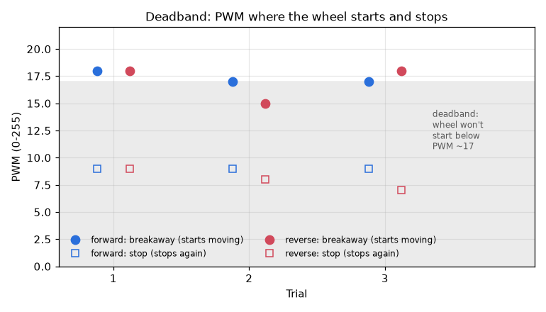
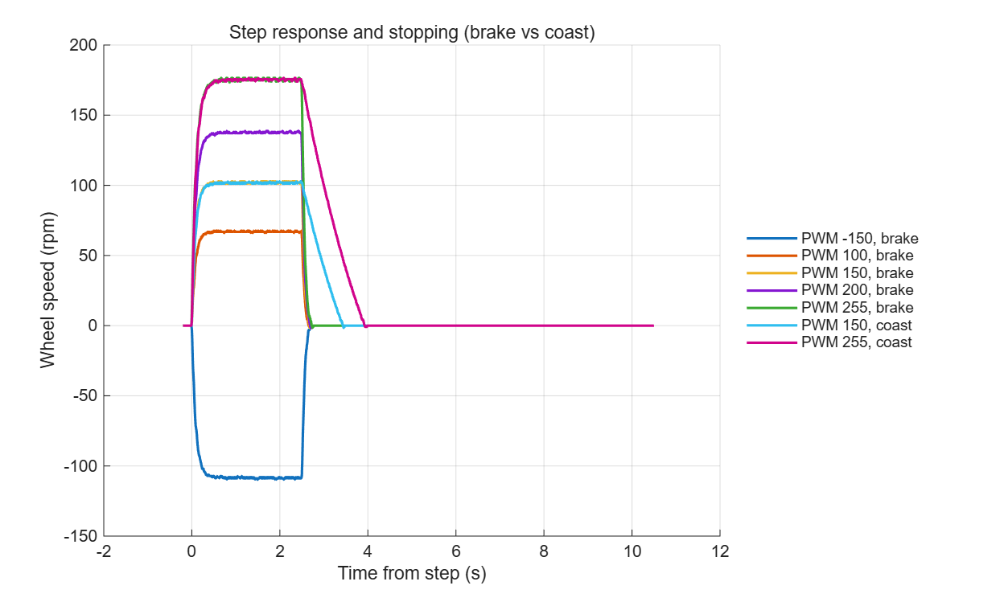
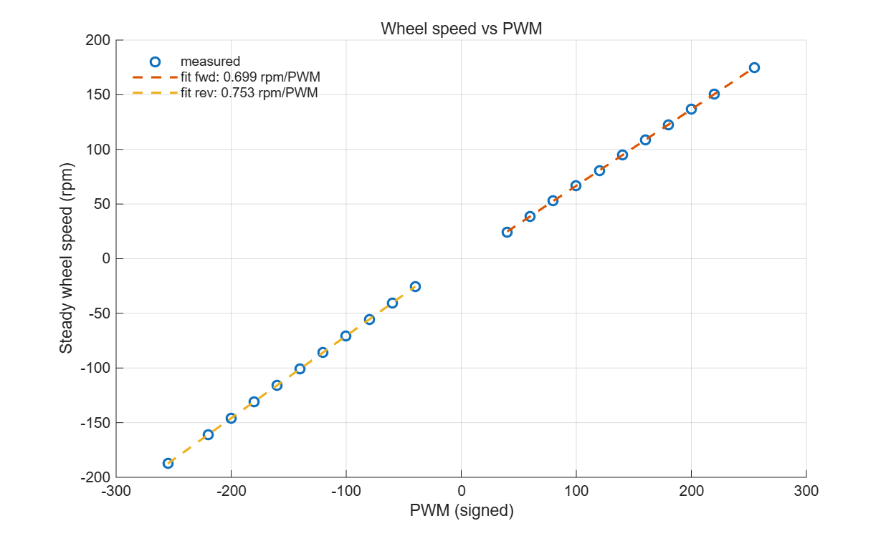
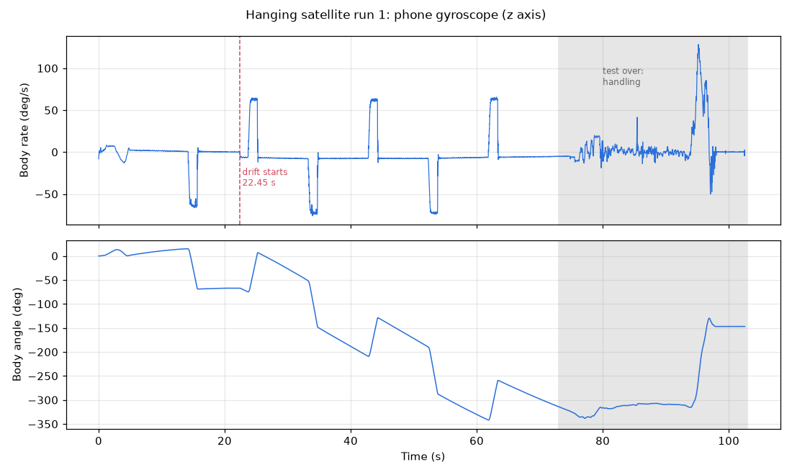

# Motor test results (2026-10-16)

Bench tests used the motor clamped on the bench, with the 100 mm steel flywheel and the 6× AA NiMH pack.

## Driver
- The DRV8874's **PMODE pin was unconnected**. With PMODE floating the driver isn't in PH/EN mode, so the code's "brake" (EN = 0) drove the motor at full speed instead.
- **Fix:** PMODE wired to GND, which gives PH/EN mode. `test_driver_mode` then confirmed PH/EN and a working brake (0 counts of drift in the 1 s after braking).

## Encoder
- **2800 counts per wheel revolution** (datasheet 700 × 4 with every edge counted). Confirmed with three one-turn runs against a tape mark.
- Forward drive makes the count go **up**, so the D2/D3 wiring is correct.
- 0.3 s pulse at PWM 100: forward +853, +853, +855 counts; reverse −907, −907, −908.

## Deadband (`deadband.csv`)
| | Breakaway PWM | Stop PWM |
|---|---|---|
| Forward | 17.3 (17–18) | 9.0 |
| Reverse | 17.0 (15–18) | 8.0 |

## Step response and stopping (`step_*.csv`, `step_responses.png`)
- Time constant **τ ≈ 0.085 s** (0.078–0.098).
- Brake stops the wheel in **0.15–0.19 s**; coasting takes 0.91 s (from PWM 150) to 1.35 s (from PWM 255).
- After braking, the wheel still slides about **speed (counts/s) × 0.053 s**: 162 counts from PWM 100, up to 474 counts (61° of wheel) from PWM 255.

## Speed curve (`speed_curve.csv`, `speed_curve.png`)
- Forward: rpm = 0.699 × PWM − 3.1, max 175 rpm.
- Reverse: rpm = 0.753 × PWM + 4.7, max 187 rpm.
- Speed is linear in PWM. Reverse is about 7% stronger.

## Starting PD gains (simulated with the numbers above)
Wheel position PD, 5 ms loop: **Kp = 1.0** PWM per count, **Kd = 0.05** PWM per (count/s).
In the simulation, a one-revolution move overshoots by 16 counts and settles within ±10 counts in 0.6 s.

## Hanging satellite, run 1 (`satellite_run1/`)
- Phone gyroscope (phyphox, iPhone) taped on top. `test_satellite` ran: 6 moves at PWM 120, 1.5 s each, then a brake and an 8 s wait.
- The encoder results (`p`) weren't read: the hardware failed after the test.
- **Inertia ratio r ≈ 0.14** (0.132–0.144), from the body rate (64–70°/s) ÷ the wheel speed at PWM 120 (485°/s, from the bench speed curve). That's about **56 encoder counts per degree of body**. The phone adds some inertia, so r without it is probably about 0.15.
- Each move turned the body 85–93°.
- After move 1 the body **stopped dead** when the wheel braked.
- At **22.45 s**, with no motor command, the body suddenly began turning at **−6.5°/s** and kept going for the rest of the test. Two possible causes:
  - an outside kick (a touch, a tug on a wire, or the swivel slipping), with the near-frictionless swivel keeping it spinning; or
  - the wheel creeping when it should have been braked (an electrical fault).
- **To be checked in run 2**, with the encoder readout.

## Hardware status
After run 1 the motor stopped working. The previous Nano had a fried capacitor, and the new Nano went into the same breadboard, which showed signs of leaked electrolyte. Before any more testing: replace the breadboard, check that the battery feeds VIN (not the 5V pin) with the right polarity, then check the driver.
